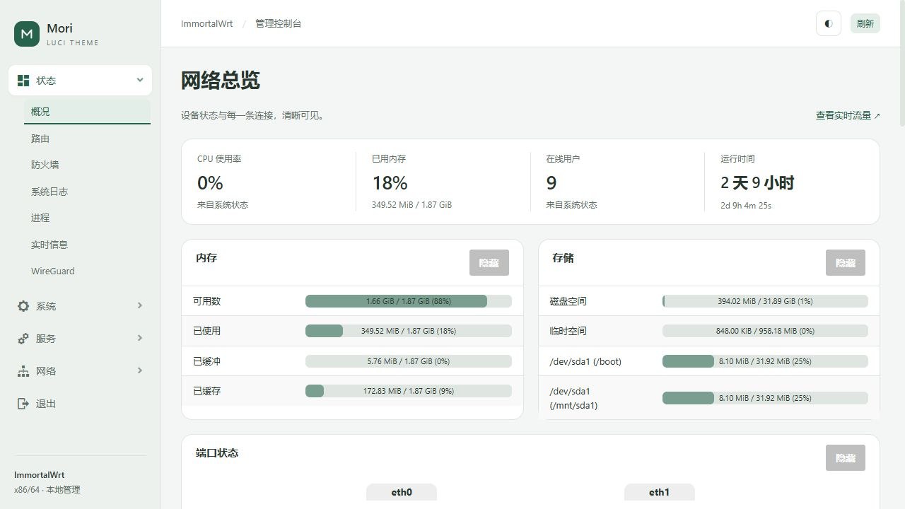
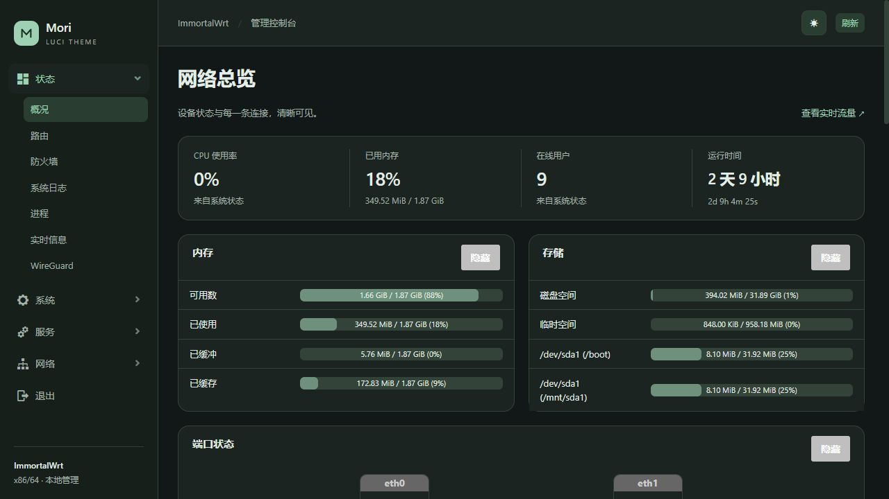

# Mori · LuCI Theme

A clean, modern LuCI theme for ImmortalWrt, with light and dark modes.

Mori（森）是一套灰绿配色的 LuCI 主题。它保留路由器原有的页面、菜单和配置流程，用更清晰的层次呈现日常需要的网络信息。

## 预览

| 浅色 | 深色 |
| --- | --- |
|  |  |

## 功能

- 浅色与深色模式，首次跟随系统外观，手动选择保存在当前浏览器。
- 首页展示真实 CPU、内存、在线用户和运行时间；系统详情放在页面下方。
- 统一原生页面的表单、表格、弹窗、按钮和实时图表样式。
- 适配桌面与窄屏布局，动态列表按钮和多行内容可正常对齐。
- 第三方插件沿用主题外壳，Mori 的原生内容覆盖不应用于插件的专用页面。
- 使用设备已有 LuCI 状态数据，不额外轮询、不修改网络、DNS、防火墙或代理配置。

Mori 随包提供所需资源和菜单脚本，不要求另外安装 Argon。项目保留了 Argon 的兼容基础及原作者署名，详见[第三方来源](THIRD_PARTY_NOTICES.md)。

## 兼容范围

当前版本面向 **ucode 模板运行时的 LuCI**。已验证的基础环境为 ImmortalWrt 25.12.0、x86/64、LuCI `26.145.09311~a701807`。不同固件分支的原生页面结构可能不同，需要分别验证。

旧版 Lua `.htm` 模板运行时不在当前支持范围内。浏览器窄屏检查不等同于所有手机设备验收；网络配置的保存与应用仍由原生 LuCI 处理。

## 安装

当前仓库提供源码和可本地生成的独立安装包。完整步骤、升级、切换主题及回退见[安装说明](docs/INSTALL.md)。

在电脑上构建：

```sh
git clone https://github.com/AobaRino/luci-theme-mori.git
cd luci-theme-mori
python3 scripts/build.py
python3 scripts/check.py
```

将生成的 `dist/luci-theme-mori-0.1.0.tar.gz` 上传到路由器并解压，然后在解压目录执行：

```sh
sh scripts/install.sh --activate
```

安装器会校验文件、检查模板并创建备份。`--activate` 表示立即切换到 Mori；省略此参数时只安装和登记主题。它不会重启路由器或网络服务，也不会执行全局配置应用。

更新后的资源带有内容版本号，刷新页面即可加载。明暗模式偏好属于浏览器设置，不写入路由器配置。

## 开发与反馈

- [开发、打包与仓库结构](docs/DEVELOPMENT.md)
- [问题反馈](https://github.com/AobaRino/luci-theme-mori/issues)

反馈时请附固件版本、LuCI 版本、浏览器及复现页面。截图请先去除密码、令牌、外网地址、设备名称和其他不希望公开的信息。

## 许可与致谢

Mori 以 [Apache License 2.0](LICENSE) 发布。保留的第三方资源及其来源见 [THIRD_PARTY_NOTICES.md](THIRD_PARTY_NOTICES.md)。

感谢 [LuCI](https://github.com/openwrt/luci) 与 [luci-theme-argon](https://github.com/jerrykuku/luci-theme-argon) 的作者和贡献者。
